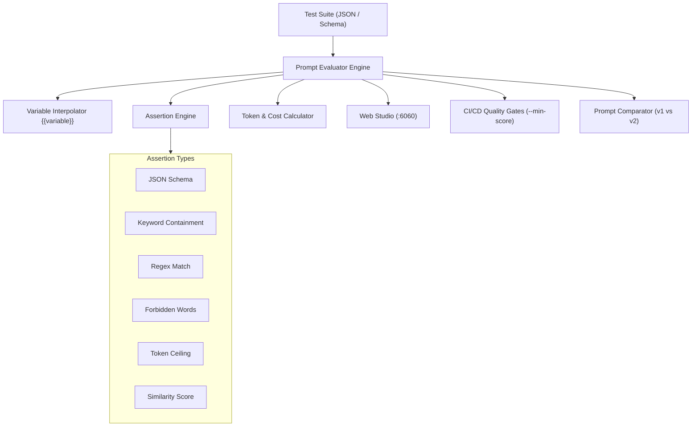

# ⚡ PromptPulse

> **Developer-First Prompt Regression Tester, LLM Output Assertion Engine & Interactive Visual Studio.**  
> Built by **[Jatin Sharma](https://jatinsh.netlify.app/)** • GitHub: **[@raghav1924](https://github.com/raghav1924)**

[](https://opensource.org/licenses/MIT)
[](https://github.com/raghav1924/promptpulse/actions)
[](https://nodejs.org/)
[](https://www.typescriptlang.org/)
[](https://github.com/raghav1924/promptpulse)
[](https://jatinsh.netlify.app/)

---

## 🌟 Why PromptPulse?

When teams iterate on system prompts, instruction templates, or AI agent personas, subtle wording edits frequently introduce hidden regressions:
- Valid structured JSON outputs break or drop required fields.
- Token counts spike, inflating inference costs without added value.
- Hallucinated tokens, apologetic filler, or forbidden phrases slip through.
- Edge cases stop satisfying baseline constraints.

**PromptPulse** is a lightweight, zero-dependency testing toolkit that brings deterministic unit testing and regression analysis to prompt engineering:
- 🧪 **Multi-Operator Assertion Engine:** Validate JSON schemas, keyword presence, regex patterns, token thresholds, and forbidden terms.
- 📉 **Regression & Delta Detector:** Compare baseline prompts against candidate prompts to measure score changes, token delta, and cost delta.
- 🎨 **Dark-Mode Visual Studio:** Inspect test runs, assertion breakdowns, and side-by-side prompt diffs on `http://localhost:6060`.
- ⚡ **Zero External Dependencies:** Built with pure TypeScript and Node.js standard libraries for instantaneous execution.
- 📖 **Cheatsheet & Guides:** See [docs/CHEATSHEET.md](docs/CHEATSHEET.md), [ARCHITECTURE.md](ARCHITECTURE.md), and [docs/PROMPT_TESTING_GUIDE.md](docs/PROMPT_TESTING_GUIDE.md) for complete operator reference and CI setup patterns.

---

## 🏗️ Architecture



---

## 🚀 Quickstart

### 1. Build and Run
```bash
# Clone the repository
git clone https://github.com/raghav1924/promptpulse.git
cd promptpulse

# Compile TypeScript
npm run build

# Run the test suite
npm test
```

### 2. CLI Commands
```bash
# Run prompt evaluation on a test suite
./dist/bin.js run examples/suite.json

# Enforce CI/CD quality gate with minimum score
./dist/bin.js run examples/suite.json --min-score 90

# Compare baseline prompt with candidate prompt for regressions
./dist/bin.js compare examples/suite.json examples/prompt_v2.txt

# Export standalone HTML report
./dist/bin.js run examples/suite.json --export report.html

# Launch interactive dark-mode Web Studio
./dist/bin.js studio examples/suite.json --port 6060
```

---

## 🧪 Supported Assertion Operators

| Operator | Purpose | Example |
|---|---|---|
| `json_schema` | Validates valid JSON and checks required keys/types | `{ "type": "json_schema", "value": { "required": ["status", "id"] } }` |
| `contains` | Ensures output includes target keyword(s) | `{ "type": "contains", "value": ["urgent", "escalate"] }` |
| `not_contains` | Ensures output excludes forbidden keywords | `{ "type": "not_contains", "value": "internal_secret" }` |
| `regex` | Pattern validation against output | `{ "type": "regex", "value": "^[A-Z0-9_-]+$" }` |
| `forbidden_words` | Flags apologetic filler ("As an AI", "Apologies") | `{ "type": "forbidden_words" }` |
| `max_tokens` | Enforces upper bound on generated tokens | `{ "type": "max_tokens", "threshold": 120 }` |
| `cost_ceiling` | Caps completion cost estimate in USD | `{ "type": "cost_ceiling", "threshold": 0.005 }` |
| `similarity` | Levenshtein distance check against ground truth | `{ "type": "similarity", "threshold": 0.85 }` |

---

## 🎨 Interactive Web Studio

When you launch `promptpulse studio`, open `http://localhost:6060` in your browser:
- **Evaluation Matrix:** View test cases with status badges, input variables, diagnostics, token usage, and cost estimates.
- **Prompt Diff Viewer:** Paste candidate prompt updates to see real-time score deltas, token usage deltas, and regression alerts.
- **System Prompt Inspector:** Modify the active prompt and immediately trigger re-evaluation.

---

## 👨‍💻 Author

**Jatin Sharma**  
- Portfolio: **[https://jatinsh.netlify.app/](https://jatinsh.netlify.app/)**  
- GitHub: **[@raghav1924](https://github.com/raghav1924)**  
- Email: [raghavjatin245@gmail.com](mailto:raghavjatin245@gmail.com)

---

## 📄 License

Licensed under the **MIT License** — see [LICENSE](LICENSE) for details.

